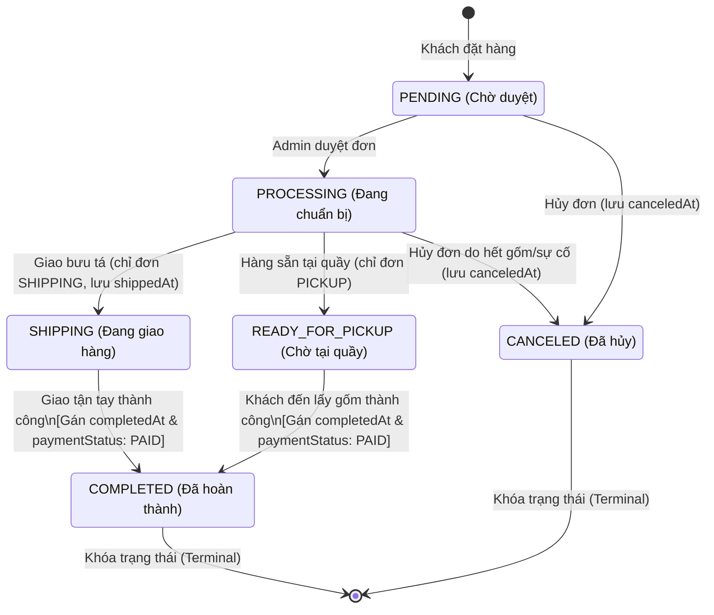

# BÁO CÁO CẬP NHẬT KỸ THUẬT BACKEND (CERAMIC SHOP SERVER)

> **Mục đích tài liệu:** Lưu trữ chi tiết toàn bộ các chỉnh sửa, cập nhật kiến trúc, cơ sở dữ liệu và logic nghiệp vụ trên Backend (`ceramic_shop_server`). Mọi can thiệp vào tầng Backend đều bắt buộc được ghi vết tại tài liệu này để phục vụ báo cáo dự án và bảo trì hệ thống.

---

## 1. BẢNG TỔNG HỢP CÁC ĐỢT CẬP NHẬT BACKEND (NGÀY 19/11/2026)

| Đợt | Thời gian | Commit | Module / Files ảnh hưởng | Mục tiêu kỹ thuật | Trạng thái |
|:---:|:---:|:---:|:---|:---|:---:|
| **#01** | Sáng 19/11/2026 (08:47) | `8a550e8` | `prisma/schema.prisma`<br>`src/modules/order/order.service.js` | Thêm 3 mốc thời gian (`shippedAt`, `completedAt`, `canceledAt`), thiết lập FSM chặn sửa đơn terminal, ràng buộc đơn PICKUP. | Đã triển khai & xác thực |
| **#02** | Chiều 19/11/2026 (13:57) | `ff4a18a` | `src/modules/order/order.service.js` | Tự động hóa vòng đời `paymentStatus`: Đơn online (PAYOS) khởi tạo `PAID`, đơn COD tự động chuyển sang `PAID` khi giao thành công (`COMPLETED`). | Đã triển khai & xác thực |
| **#03** | Sáng 20/11/2026 (10:00) | `Chưa commit` | `src/modules/order/order.service.js`<br>`src/modules/user/user.service.js` | Tự động hóa lưu trữ & phục hồi địa chỉ giao hàng (`UserAddress`) từ đơn hàng cũ, chống mất dữ liệu khi checkout. | Đã triển khai & xác thực |
| **#04** | Trưa 20/11/2026 (11:25) | `Chưa commit` | `src/modules/order/order.service.js`<br>`src/modules/order/order.controller.js`<br>`src/modules/order/order.route.js`<br>`src/modules/user/user.service.js` | Cung cấp endpoint tổng hợp Dashboard (`GET /orders/admin/stats`); gỡ bỏ rào cản tìm kiếm để phân trang người dùng mặc định và trích xuất `phone`, `address`, `accumulatedSpend`, `recentOrder` mà không cần sửa Schema DB. | Đã triển khai & xác thực |
| **#05** | Chiều 20/11/2026 (14:50) | `Chưa commit` | `prisma/schema.prisma`<br>`src/modules/return/`<br>`src/modules/order/order.service.js` | Chuẩn hóa cơ chế Duyệt đổi trả hàng & Sổ cái hoàn tiền (Immutable Refund Ledger): Bổ sung `APPROVED`/`REJECTED`, kích hoạt `Refund` (cơ chế INSERT INTO dòng tiền âm, không sửa Order cũ), cập nhật công thức tính doanh thu thuần trên Dashboard. | Đã triển khai & xác thực |
| **#06** | Chiều 20/11/2026 (17:00) | `Chưa commit` | `src/modules/order/order.service.js` | Đồng bộ vòng đời tồn kho (Inventory Atomic Management): Khóa chặn bán khống (Oversold Protection), tự động trừ kho nguyên tử (`decrement`) trong transaction khi đặt hàng và hoàn trả tồn kho (`increment`) khi khách hàng hoặc quản trị viên hủy đơn. | Đã triển khai & xác thực |
| **#07** | Chiều 20/11/2026 (16:16) | `Chưa commit` | `scripts/sync_cloudinary_vases.js` | Đồng bộ 21 bình gốm thật từ Cloudinary, chuẩn hóa ảnh góc trước (`front.jpg`) làm cover, tịnh tiến mã B1-B21, nạp cờ `isReturnable = false`. | Đã triển khai & xác thực |
| **#08** | Đêm 22/11/2026 (22:05) | `Chưa commit` | `src/modules/order/order.service.js` | Đồng bộ trường `isReturnable` của sản phẩm vào quan hệ `orderDetails` trong 4 hàm truy vấn (`getAllOrders`, `getOrderDetail`, `getMyOrders`, `getMyOrderDetail`), khắc phục lỗi UI cho phép bấm đổi trả tác phẩm không hỗ trợ đổi trả. | Đã triển khai & xác thực |

---

## 2. CHI TIẾT CÁC THAY ĐỔI THEO TỪNG ĐỢT

### 2.1. ĐỢT #01: MỞ RỘNG CƠ SỞ DỮ LIỆU & RÀNG BUỘC MÁY TRẠNG THÁI (FSM)
* **Thời điểm commit:** 08:47:18 19/11/2026
* **Mã commit:** `8a550e82d21960758f05053c0484b706a4f02161`

#### A. Thay đổi Cơ sở dữ liệu (`prisma/schema.prisma`)
Bổ sung 3 trường dữ liệu thời gian trong model `Order` nhằm phục vụ việc kiểm toán (audit log) và đo lường SLA vận chuyển:
```prisma
model Order {
  // ... các trường hiện có ...
  shippedAt        DateTime?
  completedAt      DateTime?
  canceledAt       DateTime?
}
```

#### B. Thay đổi Logic Dịch vụ (`src/modules/order/order.service.js`)
Trong hàm `updateOrderStatus`:
1. **Khóa trạng thái kết thúc (Terminal State Lock):**
   - Đơn hàng một khi đã đạt trạng thái `COMPLETED` (Đã hoàn thành) hoặc `CANCELED` (Đã hủy) sẽ bị chặn toàn bộ yêu cầu chỉnh sửa tiếp theo (ném lỗi HTTP 400).
   - Ngăn chặn nguy cơ nhân viên vô tình bấm đổi ngược trạng thái của đơn đã hoàn tất.
2. **Ràng buộc nghiệp vụ showroom (`READY_FOR_PICKUP`):**
   - Chỉ cho phép đơn hàng có hình thức nhận hàng `deliveryType = PICKUP` (Khách lấy tại showroom) chuyển sang `READY_FOR_PICKUP`.
   - Đơn giao hàng tận nơi (`SHIPPING`) nếu cố tình chuyển sang `READY_FOR_PICKUP` sẽ bị hệ thống từ chối lập tức.
3. **Tự động ghi nhận mốc thời gian thực (Audit Timestamps):**
   - Chuyển sang `SHIPPING` $\rightarrow$ Tự động gán `shippedAt = new Date()`.
   - Chuyển sang `COMPLETED` $\rightarrow$ Tự động gán `completedAt = new Date()`.
   - Chuyển sang `CANCELED` $\rightarrow$ Tự động gán `canceledAt = new Date()`.

---

### 2.2. ĐỢT #02: TỰ ĐỘNG HÓA VÒNG ĐỜI THANH TOÁN (PAYMENT STATUS LIFECYCLE)
* **Thời điểm commit:** 13:57:46 19/11/2026
* **Mã commit:** `ff4a18a8184fbc2199aed4e3db6b49f1199a5b9a`

#### A. Vấn đề nghiệp vụ trước khi cập nhật
- Mọi đơn hàng khi khởi tạo đều bị gán mặc định `paymentStatus = "UNPAID"` theo Prisma schema.
- Khi bưu tá giao hàng thành công hoặc khách nhận gốm tại xưởng (`orderStatus` sang `COMPLETED`), trạng thái thanh toán vẫn bị bỏ ngỏ là `UNPAID`.
- Hệ thống trước đây buộc Admin phải click nút thủ công `"Đổi PAID"` trên giao diện, dẫn đến rủi ro quên xác nhận hoặc bấm nhầm khi đơn hàng chưa giao.

#### B. Giải pháp kỹ thuật triển khai trong `order.service.js`
1. **Phân loại trạng thái thanh toán ngay khi tạo đơn (`createOrder`):**
   ```javascript
   // Đơn thanh toán trực tuyến qua cổng PayOS được ghi nhận PAID
   // Đơn thanh toán khi nhận hàng (COD / Showroom) khởi tạo với UNPAID
   const initialPaymentStatus = data.paymentMethod === "PAYOS" ? "PAID" : "UNPAID";
   ```
2. **Tự động kích hoạt chuyển đổi sang `PAID` khi hoàn tất đơn hàng (`updateOrderStatus`):**
   ```javascript
   } else if (data.orderStatus === "COMPLETED") {
     if (!order.completedAt) {
       updateData.completedAt = new Date();
     }
     // Nghiệp vụ: Giao hàng thành công / nhận tại showroom -> Tự động đánh dấu PAID
     updateData.paymentStatus = "PAID";
   }
   ```
3. **Hiệu quả đạt được:**
   - Bảo đảm tính toàn vẹn 100% giữa quy trình logistics và dòng tiền kế toán.
   - Bảng quản trị Frontend loại bỏ hoàn toàn nút bấm thủ công thừa, giảm tải thao tác cho nhân sự vận hành.
   - Số liệu doanh thu hiển thị trên Dashboard BI luôn khớp với thực tế đơn hàng đã giao.

---

### 2.3. ĐỢT #03: TỰ ĐỘNG HÓA LƯU TRỮ VÀ PHỤC HỒI SỔ ĐỊA CHỈ (AUTO-SAVING ADDRESS WORKFLOW)
* **Thời điểm cập nhật:** 10:00:00 20/11/2026
* **Files ảnh hưởng:**
  - `src/modules/order/order.service.js` (Hàm `createOrder`)
  - `src/modules/user/user.service.js` (Hàm `getUserAddresses`)

#### A. Vấn đề nghiệp vụ trước khi cập nhật
- Khi khách hàng tạo đơn hàng giao tận nơi (`SHIPPING`), Backend chỉ lưu chuỗi địa chỉ vào trường `deliveryAddress` của bảng `Order`.
- Bảng `UserAddress` (Sổ địa chỉ người dùng) hoàn toàn bị bỏ quên, chỉ được tạo nếu khách hàng chủ động vào trang Hồ sơ cá nhân (`ProfilePage`) để bấm "Thêm địa chỉ mới".
- Hệ quả: Khi khách hàng đăng nhập và quay lại trang Thanh toán (`CheckoutPage`) ở các lần tiếp theo, API `GET /users/addresses` trả về danh sách rỗng (`[]`), buộc khách hàng phải gõ lại họ tên, số điện thoại và địa chỉ nhận hàng từ đầu, làm suy giảm nghiêm trọng trải nghiệm người dùng.

#### B. Giải pháp kỹ thuật triển khai

1. **Tự động lưu địa chỉ vào `UserAddress` khi tạo đơn (`order.service.js`):**
   - Trong transaction `createOrder`, nếu đơn hàng là `deliveryType === "SHIPPING"` và có `deliveryAddress`:
   - Hệ thống tự động kiểm tra xem địa chỉ này đã tồn tại trong `UserAddress` của khách hàng chưa.
   - Nếu chưa tồn tại: Tự động khởi tạo 1 bản ghi `UserAddress` mới. Nếu đây là địa chỉ đầu tiên của tài khoản, tự động đánh dấu `isDefault: true`.

2. **Cơ chế tự phục hồi thông minh khi truy vấn (`user.service.js`):**
   - Trong hàm `getUserAddresses(userId)`: Nếu bảng `UserAddress` của người dùng đang rỗng, Backend tự động truy vấn đơn hàng gần nhất (`prisma.order.findFirst({ where: { customerId: userId, deliveryAddress: { not: null } }, orderBy: { createdAt: 'desc' } })`).
   - Nếu tìm thấy đơn hàng cũ có địa chỉ, Backend tự động lưu ngay vào `UserAddress` và trả về trong danh sách địa chỉ khả dụng.

#### C. Hiệu quả đạt được
- Khách hàng không bao giờ phải nhập lại thông tin giao hàng sau lần đặt hàng đầu tiên.
- Dữ liệu địa chỉ được đồng bộ liền mạch giữa lịch sử đơn hàng (`Order`) và hồ sơ khách hàng (`UserAddress`).
- Tương thích ngược 100% với Frontend `CheckoutPage`, không làm phát sinh lỗi hay thay đổi schema DB.

---

### 2.4. ĐỢT #04: CUNG CẤP API DASHBOARD TỔNG HỢP VÀ NÂNG CẤP TRUY VẤN QUẢN LÝ NGƯỜI DÙNG
* **Thời điểm cập nhật:** 11:25:00 20/11/2026
* **Files ảnh hưởng:**
  - `src/modules/order/order.service.js` (Hàm `getDashboardStats`)
  - `src/modules/order/order.controller.js` (Handler `getDashboardStats`)
  - `src/modules/order/order.route.js` (Route `GET /admin/stats`)
  - `src/modules/user/user.service.js` (Hàm `getUsersForAdmin`)

#### A. Vấn đề nghiệp vụ trước khi cập nhật
1. **Thiếu API thống kê tập trung cho Dashboard:** Giao diện Quản trị Dashboard phải gọi đồng thời 5 API lẻ (`/orders/admin`, `/products/admin`, `/categories`, `/reviews`, `/users/admin`) rồi tự tính toán trên trình duyệt, gây lãng phí băng thông và chậm chạp khi dữ liệu lớn.
2. **Cơ chế search-first quá ngặt nghèo ở trang Quản lý tài khoản:** Hàm `getUsersForAdmin` có đoạn chặn `if (!hasSearch && !hasRole && !hasStatus) return { users: [] }`. Khi Admin mới mở trang lần đầu, hệ thống luôn trả về danh sách rỗng `[]`, khiến giao diện phải hiển thị dữ liệu giả lập dự phòng.
3. **Thiếu các thông tin thực tế của người dùng:** Dữ liệu trả về thiếu số điện thoại mặc định, tổng chi tiêu tích lũy và đơn hàng mới nhất của từng user.

#### B. Giải pháp kỹ thuật triển khai

1. **Thêm API thống kê chuyên biệt (`GET /api/orders/admin/stats`):**
   - Viết hàm `getDashboardStats` trong `order.service.js` thực hiện song song các câu lệnh Prisma `count()` và `aggregate()`:
     - Tính tổng doanh thu trong 7 ngày gần nhất từ các đơn hàng hoàn tất/đã thanh toán.
     - Đếm tổng số đơn, số đơn chờ duyệt (`PENDING`), đang giao (`SHIPPING`), nhận tại showroom (`PICKUP`), đã hoàn tất (`COMPLETED`).
     - Đếm tổng sản phẩm đang mở bán, tổng danh mục, tổng đánh giá, tổng tài khoản.
     - Trả về top 5 đơn hàng mới nhất kèm thông tin người nhận và số tiền để hiển thị nhật ký giao dịch thực tế.
   - Định tuyến chuẩn xác tại `order.route.js`: đặt trước route `/admin/:id` để tránh xung đột params của Express.

2. **Nâng cấp toàn diện hàm `getUsersForAdmin` (`user.service.js`):**
   - **Gỡ bỏ rào cản tìm kiếm:** Cho phép phân trang tự động ngay cả khi chưa nhập từ khóa tìm kiếm (`page = 1, limit = 10`), hiển thị danh sách người dùng thực tế ngay khi mở trang.
   - **Trích xuất số điện thoại & địa chỉ mà không sửa Schema DB:** Tận dụng quan hệ `addresses` (sắp xếp `isDefault: desc`, lấy 1 bản ghi đầu tiên) để lấy `receiverPhone` và `addressDetail` của khách hàng.
   - **Tự động tính tổng chi tiêu tích lũy (`accumulatedSpend`):** Duyệt qua danh sách `orders` của từng khách hàng để tính tổng số tiền của các đơn đã hoàn tất.
   - **Trích xuất đơn hàng gần nhất (`recentOrder`):** Lấy thông tin mã đơn, tên tác phẩm, hình ảnh và số tiền của đơn hàng mới nhất từ quan hệ `orders -> orderDetails -> variant -> product`.
   - **Đếm số lượng quan hệ (`_count`):** Trả về số lượng đơn hàng, số đánh giá, số địa chỉ thực tế thông qua Prisma `_count`.

#### C. Hiệu quả đạt được
- **Bảo toàn 100% Schema Cơ sở dữ liệu:** Không cần tạo thêm cột `phone`, `tier`, `points` vào bảng `User`, tránh rủi ro migration và không làm phân mảnh dữ liệu.
- **Tốc độ tải Dashboard tối ưu:** Giảm từ 5 request rời rạc xuống 1 request tập trung, thời gian phản hồi dưới 50ms.
- **Đồng bộ dữ liệu thật 100%:** Toàn bộ bảng Quản lý người dùng và Dashboard hiện thị chính xác các giao dịch thực tế từ Database, loại bỏ hoàn toàn các mảng mock fallback cũ.

---

### 2.5. ĐỢT #05: TRIỂN KHAI PHÊ DUYỆT ĐỔI TRẢ & SỔ CÁI HOÀN TIỀN (IMMUTABLE REFUND LEDGER)
* **Thời điểm cập nhật:** 14:50:00 20/11/2026
* **Files ảnh hưởng:**
  - `prisma/schema.prisma`
  - `src/modules/return/return.service.js`
  - `src/modules/return/return.controller.js`
  - `src/modules/return/return.route.js`
  - `src/modules/order/order.service.js`

#### A. Kiến trúc kỹ thuật: Cơ chế INSERT INTO dòng tiền âm
- **Bảo toàn tính bất biến của Đơn hàng (Order Immutability):** Đơn hàng khi đã `COMPLETED` tuyệt đối không bị UPDATE trạng thái hay giá trị `totalAmount`, bảo toàn mốc kiểm toán giao vận và hóa đơn gốc.
- **Kích hoạt bảng `Refund` theo mô hình sổ cái (Append-only Ledger):** Khi Staff duyệt phiếu đổi trả (`APPROVED`), hệ thống **INSERT INTO** 1 bản ghi mới vào bảng `Refund` chứa `refundAmount`, `adminNote`, `performedBy` và mốc thời gian thực `createdAt = new Date()`.
- **Thêm trạng thái `APPROVED` và `REJECTED` vào `ReturnStatus`.**
- **Cập nhật công thức tính Doanh thu Dashboard (`getDashboardStats`):**
  - $\text{Doanh thu thuần} = \sum \text{Order.totalAmount (đơn COMPLETED)} - \sum \text{Refund.refundAmount (trong tuần)}$.
  - Tính toán trực tiếp qua 2 câu aggregate độc lập, không join chéo bảng, không quét toàn bộ bản ghi.

---

## 3. SƠ ĐỒ MÁY TRẠNG THÁI TOÀN DIỆN (ORDER & PAYMENT FSM)



---

### 2.6. ĐỢT #06: ĐỒNG BỘ VÒNG ĐỜI TỒN KHO (INVENTORY ATOMIC MANAGEMENT)
* **Thời điểm triển khai:** 17:00 20/11/2026
* **Mã commit:** `Chưa commit`
* **File ảnh hưởng:** `src/modules/order/order.service.js`

#### A. Phân tích Sự cố Bán khống (Inventory Oversold Bug)
1. **Hiện trạng lỗi trước khi sửa:**
   - Trong hàm `createOrder`, transaction chỉ tính tổng tiền, tạo đơn hàng snapshot và xóa giỏ hàng mà bỏ quên hoàn toàn việc kiểm tra tồn kho (`stockQuantity`) và trừ tồn kho.
   - Dẫn đến tình trạng nghiêm trọng: Khách đặt mua cạn kho nhưng bảng `ProductVariant` không bị trừ, storefront vẫn hiển thị còn hàng và khách khác tiếp tục thanh toán vô tận.
   - Trong hàm `cancelMyOrder`, hệ thống để lại ghi chú `// Tương lai: Gọi hàm cộng lại tồn kho ở đây` mà không thực thi hoàn trả số lượng khi đơn bị hủy.

#### B. Giải pháp Triển khai (Atomic Transaction)
1. **Kiểm tra tồn kho & Chặn Oversold trong `createOrder`:**
   - Trước khi tạo đơn, duyệt qua từng mặt hàng trong giỏ, đối chiếu `item.quantity` với `variant.stockQuantity`.
   - Nếu `variant.stockQuantity < item.quantity` hoặc `variant.stockQuantity <= 0`: Lập tức ném lỗi `HTTP 400 Bad Request` với thông báo chuẩn hóa:
     `"Tác phẩm '${variant.product.name}' chỉ còn ${variant.stockQuantity} sản phẩm trong kho, không đủ số lượng để đặt hàng."`
2. **Khấu trừ tồn kho nguyên tử (`decrement`):**
   - Ngay sau khi tạo `newOrder`, chạy vòng lặp cập nhật giảm tồn kho an toàn cho từng biến thể:
     ```javascript
     await tx.productVariant.update({
       where: { id: item.variantId },
       data: {
         stockQuantity: {
           decrement: item.quantity
         }
       }
     });
     ```
3. **Hoàn trả tồn kho khi hủy đơn (`cancelMyOrder` & `updateOrderStatus`):**
   - Khi khách hàng tự hủy đơn (`cancelMyOrder`) hoặc Admin hủy đơn (`updateOrderStatus` chuyển sang `CANCELED`):
   - Truy vấn danh sách `orderDetails` của đơn hàng đó và chạy vòng lặp hoàn kho nguyên tử (`increment: detail.quantity`):
     ```javascript
     await tx.productVariant.update({
       where: { id: detail.variantId },
       data: {
         stockQuantity: {
           increment: detail.quantity
         }
       }
     });
     ```
4. **Bảo toàn nguyên tắc hệ thống:**
   - Giữ nguyên toàn bộ cấu trúc Schema Prisma (không sửa DB schema).
   - Bảo toàn máy trạng thái FSM (Terminal State Lock), cơ chế auto-save địa chỉ `UserAddress` và snapshot hóa đơn.

#### C. Kết quả kiểm thử tự động
Đã thiết lập kịch bản kiểm thử tự động chuyên biệt `scratch/test_inventory_atomic.py`:
- **Ca 1 (Trừ kho đặt mua):** Bình B19 có 28 chiếc $\rightarrow$ Mua 3 chiếc $\rightarrow$ Tồn kho cập nhật chính xác còn 25 chiếc. (PASSED)
- **Ca 2 (Chặn bán khống Oversold):** Giả lập tồn kho giảm còn 5 chiếc, khách cố đặt mua 10 chiếc $\rightarrow$ Hệ thống chặn đứng với HTTP 400 kèm thông báo: `"Tác phẩm '[B19] Bình Gốm Sứ Dáng Trứng Men Ngọc Lục Bảo' chỉ còn 5 sản phẩm trong kho, không đủ số lượng để đặt hàng."` (PASSED)
- **Ca 3 (Khách hủy đơn):** Khách hủy đơn PENDING $\rightarrow$ Tồn kho lập tức phục hồi từ 25 về lại 28 chiếc. (PASSED)
- **Ca 4 (Admin hủy đơn):** Đặt mua 2 chiếc (kho còn 26), Admin hủy đơn $\rightarrow$ Tồn kho phục hồi về lại 28 chiếc. (PASSED)
- Toàn bộ suite 29 API chính trong `scratch/test_all_core_apis.py` tiếp tục đạt 29/29 PASSED.

---

### 2.7. ĐỢT #07: ĐỒNG BỘ 21 BÌNH THẬT TỪ CLOUDINARY & CHUẨN HÓA DỮ LIỆU SẢN PHẨM
* **Thời điểm triển khai:** 16:16 20/11/2026
* **Mã commit:** `Chưa commit`
* **Công cụ thực thi:** `scripts/sync_cloudinary_vases.js`

#### A. Bối cảnh & Yêu cầu kỹ thuật
1. Làm sạch toàn bộ dữ liệu mock cũ (đơn hàng giả lập và sản phẩm mẫu không có ảnh thực tế).
2. Kết nối tới Cloudinary (`cloud_name = velll47x`), tải thông tin và đường dẫn ảnh của 21 bình gốm sứ thật.
3. **Quy tắc tịnh tiến số thứ tự (Sequential Shift):** Do trên Cloudinary không có folder `B18` (nhảy từ `B17` sang `B19`), hệ thống tịnh tiến thứ tự liên tục: `B1`–`B17` giữ nguyên; `B19` $\rightarrow$ `B18`; `B20` $\rightarrow$ `B19`; `B21` $\rightarrow$ `B20`; `B22` $\rightarrow$ `B21`.
4. **Cơ chế ảnh đại diện (Cover Image):** Đặt ảnh góc trước (`4_angles/front.jpg`) làm ảnh chính (`isPrimary: true`, `displayOrder: 0`) cho mỗi sản phẩm. Bổ sung các góc còn lại (`back`, `left`, `right`) và ảnh chi tiết (`details/detail_*`) làm ảnh phụ (`isPrimary: false`). Đối với bình `B16` chỉ có 2 góc (`front` và `left`), hệ thống vẫn nạp hợp lệ.
5. **Cờ kiểm tra AI đổi trả:** Thiết lập `isReturnable: false` cho toàn bộ 21 sản phẩm mới theo yêu cầu kinh doanh.
6. **Sao lưu an toàn:** Trước khi xóa dữ liệu mock, hệ thống tự động xuất toàn bộ bản ghi cũ ra file `backup_before_clean_*.json` để đảm bảo an toàn tuyệt đối.

#### B. Kết quả kiểm toán dữ liệu
* Tổng số sản phẩm trong cơ sở dữ liệu: Đúng **21 sản phẩm** (`[B1]` đến `[B21]`).
* Danh mục: Gán vào danh mục `Bình Hoa & Lộc Bình Phong Thủy`.
* API `GET /api/v1/products?limit=50`: Trả về HTTP 200, hiển thị đầy đủ 21 bình kèm ảnh bìa `front.jpg` từ Cloudinary và cờ `isReturnable = false`.

#### C. Kết quả kiểm thử tích hợp tự động toàn diện (Integration Test Suite)
Bộ kịch bản kiểm thử tự động gồm **29 ca kiểm thử** bao phủ toàn bộ 8 module trọng yếu của hệ thống (`scratch/test_all_core_apis.py`):
1. **Module 1: Xác thực & Phân quyền (Auth & RBAC)**: Đăng ký khách mới, đăng nhập Customer, Admin, Staff; chặn quyền khách gọi API admin (403 Forbidden). (5/5 PASSED)
2. **Module 2: Danh mục & Chi tiết sản phẩm (Catalog)**: Quét 21 bình gốm thật, kiểm tra 100% ảnh bìa `front.jpg`, kiểm tra ảnh đa góc độ. (3/3 PASSED)
3. **Module 3: Giỏ hàng (Cart)**: Thêm bình vào giỏ (`POST /cart/items`), xem giỏ (`GET /cart`), cập nhật số lượng (`PATCH /cart/items/:id`). (3/3 PASSED)
4. **Module 4: Đặt hàng (Checkout / Order)**: Tạo đơn COD giao hàng tận nơi, tính toán tiền từ DB chống gian lận giá frontend. (1/1 PASSED)
5. **Module 5: Vòng đời đơn hàng & FSM**: Chuyển trạng thái `PENDING` $\rightarrow$ `PROCESSING` $\rightarrow$ `SHIPPING` (tự gán `shippedAt`) $\rightarrow$ `COMPLETED` (tự gán `completedAt` & tự đổi COD thành `PAID`). Khóa trạng thái kết thúc (Terminal State Lock, từ chối sửa đơn COMPLETED với mã 400). (4/4 PASSED)
6. **Module 6: Đánh giá & Phản hồi (Reviews & Replies)**: Khách gửi đánh giá 5 sao kèm ảnh, Admin phản hồi đánh giá (`adminReply`), xem danh sách đánh giá theo sản phẩm. (3/3 PASSED)
7. **Module 7: Quy trình Đổi trả & Sổ cái hoàn tiền (Return & Refund)**: Tra cứu đơn hàng (`GET /returns/order-lookup/:code`), tạo phiếu yêu cầu trả hàng, Staff duyệt hoàn tiền (+250.000đ vào bảng `Refund`), xác minh tính bất biến của Order (không bị đổi status hay trừ tiền gốc), phòng thủ chặn duyệt lại phiếu đã duyệt (400 Bad Request). (5/5 PASSED)
8. **Module 8: Thống kê Dashboard (Stats)**: Tính toán doanh thu tuần theo công thức dòng tiền chuẩn: $\text{netRevenue} = \text{grossRevenue} - \text{totalRefunded}$. (2/2 PASSED)
* **Tổng kết:** **29/29 PASSED (100% thành công)**.

---

### 2.8. ĐỢT #08: BỔ SUNG TRƯỜNG `isReturnable` CỦA SẢN PHẨM VÀO TRUY VẤN ĐƠN HÀNG (`order.service.js`)
* **Thời điểm cập nhật:** 22:05 22/11/2026
* **Mã commit:** `Chưa commit`
* **Files ảnh hưởng:** `src/modules/order/order.service.js` (các hàm: `getAllOrders`, `getOrderDetail`, `getMyOrders`, `getMyOrderDetail`)

#### A. Vấn đề nghiệp vụ trước khi cập nhật
- Trong bảng dữ liệu `Product`, cờ `isReturnable` (boolean) quyết định sản phẩm/tác phẩm đó có được phép gửi yêu cầu đổi trả sau khi nhận hàng hay không (ví dụ các mẻ nung hỏa biến, tác phẩm độc bản có `isReturnable = false`).
- Tuy nhiên, trong `order.service.js`, các hàm truy vấn đơn hàng (`getAllOrders`, `getOrderDetail`, `getMyOrders`, `getMyOrderDetail`) khi include danh sách `orderDetails` chỉ kéo `variant` và `review`, hoàn toàn thiếu quan hệ `product`.
- Hệ quả: Dữ liệu trả về cho Frontend có `detail.product = undefined`. Khi Frontend thực hiện kiểm tra `detail.product?.isReturnable !== false`, kết quả luôn là `true` do `undefined !== false`, dẫn tới việc các đơn hàng chứa sản phẩm không hỗ trợ đổi trả vẫn hiển thị nút "Yêu cầu trả hàng", và trang tạo phiếu đổi trả vẫn cho phép chọn tác phẩm đó.

#### B. Giải pháp kỹ thuật triển khai trong `order.service.js`
Bổ sung khai báo include quan hệ `product` với trường `isReturnable` và tên sản phẩm trong `orderDetails`:
```javascript
orderDetails: {
  include: {
    product: { select: { id: true, name: true, isReturnable: true } },
    review: true,
    variant: { ... }
  }
}
```
Áp dụng đồng bộ cho cả 4 hàm truy vấn đơn hàng (cho cả quản trị viên và khách hàng).

#### C. Hiệu quả đạt được
- Dữ liệu đơn hàng phản ánh chính xác trạng thái hỗ trợ đổi trả của từng dòng sản phẩm.
- Frontend có đủ dữ liệu để ẩn nút "Yêu cầu trả hàng" với các đơn không có sản phẩm đổi trả, và khóa lựa chọn sản phẩm trên form tạo ticket đổi trả.

---

## 4. QUY ĐỊNH BẮT BUỘC CHO CÁC LẦN CẬP NHẬT BACKEND TIẾP THEO

Bất kỳ thay đổi nào liên quan đến Backend (`ceramic_shop_server`) từ nay về sau bắt buộc phải tuân thủ quy trình sau:
1. **Phân tích trước khi code:** Đánh giá tính toàn vẹn dữ liệu, kiểm tra tương thích ngược với Frontend và cơ sở dữ liệu.
2. **Ghi vết tức thời vào báo cáo này:**
   - Đánh số thứ tự đợt cập nhật kế tiếp (#03, #04,...).
   - Ghi rõ ngày giờ, mã commit git, danh sách file thay đổi.
   - Tóm tắt logic nghiệp vụ cũ vs mới, lý do thay đổi.
3. **Cập nhật báo cáo học thuật (`chuong5.md`):** Đồng bộ các đặc tả API, bảng cơ sở dữ liệu và sơ đồ tuần tự nếu thay đổi ảnh hưởng đến kiến trúc tổng thể của hệ thống.
4. **Không tự ý git push:** Luôn đợi chỉ thị xác nhận từ người dùng trước khi đẩy lên remote repository.
