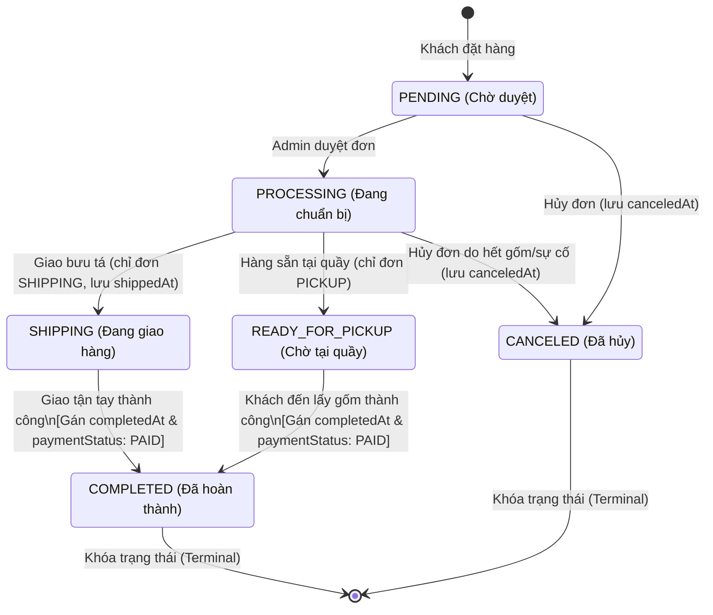

# BÁO CÁO CẬP NHẬT KỸ THUẬT BACKEND (CERAMIC SHOP SERVER)

> **Mục đích tài liệu:** Lưu trữ chi tiết toàn bộ các chỉnh sửa, cập nhật kiến trúc, cơ sở dữ liệu và logic nghiệp vụ trên Backend (`ceramic_shop_server`). Mọi can thiệp vào tầng Backend đều bắt buộc được ghi vết tại tài liệu này để phục vụ báo cáo dự án và bảo trì hệ thống.

---

## 1. BẢNG TỔNG HỢP CÁC ĐỢT CẬP NHẬT BACKEND (NGÀY 19/11/2026)

| Đợt | Thời gian | Commit | Module / Files ảnh hưởng | Mục tiêu kỹ thuật | Trạng thái |
|:---:|:---:|:---:|:---|:---|:---:|
| **#01** | Sáng 19/11/2026 (08:47) | `8a550e8` | `prisma/schema.prisma`<br>`src/modules/order/order.service.js` | Thêm 3 mốc thời gian (`shippedAt`, `completedAt`, `canceledAt`), thiết lập FSM chặn sửa đơn terminal, ràng buộc đơn PICKUP. | Đã triển khai & xác thực |
| **#02** | Chiều 19/11/2026 (13:57) | `ff4a18a` | `src/modules/order/order.service.js` | Tự động hóa vòng đời `paymentStatus`: Đơn online (PAYOS) khởi tạo `PAID`, đơn COD tự động chuyển sang `PAID` khi giao thành công (`COMPLETED`). | Đã triển khai & xác thực |

---

## 2. CHI TIẾT CÁC THAY ĐỔI THEO TỪNG ĐỢT

### 2.1. ĐỢT #01: MỞ RỘNG CƠ SỞ DỮ LIỆU & RÀNG BUỘC MÁY TRẠNG THÁI (FSM)
* **Thời điểm commit:** 08:47:18 19/11/2026
* **Mã commit:** `8a550e82d21960758f05053c0484b706a4f02161`

#### A. Thay đổi Cơ sở dữ liệu (`prisma/schema.prisma`)
Bổ sung 3 trường dữ liệu thời gian trong model `Order` nhằm phục vụ việc kiểm toán (audit log) và đo lường SLA vận chuyển:
```prisma
model Order {
  // ... các trường hiện có ...
  shippedAt        DateTime?
  completedAt      DateTime?
  canceledAt       DateTime?
}
```

#### B. Thay đổi Logic Dịch vụ (`src/modules/order/order.service.js`)
Trong hàm `updateOrderStatus`:
1. **Khóa trạng thái kết thúc (Terminal State Lock):**
   - Đơn hàng một khi đã đạt trạng thái `COMPLETED` (Đã hoàn thành) hoặc `CANCELED` (Đã hủy) sẽ bị chặn toàn bộ yêu cầu chỉnh sửa tiếp theo (ném lỗi HTTP 400).
   - Ngăn chặn nguy cơ nhân viên vô tình bấm đổi ngược trạng thái của đơn đã hoàn tất.
2. **Ràng buộc nghiệp vụ showroom (`READY_FOR_PICKUP`):**
   - Chỉ cho phép đơn hàng có hình thức nhận hàng `deliveryType = PICKUP` (Khách lấy tại showroom) chuyển sang `READY_FOR_PICKUP`.
   - Đơn giao hàng tận nơi (`SHIPPING`) nếu cố tình chuyển sang `READY_FOR_PICKUP` sẽ bị hệ thống từ chối lập tức.
3. **Tự động ghi nhận mốc thời gian thực (Audit Timestamps):**
   - Chuyển sang `SHIPPING` $\rightarrow$ Tự động gán `shippedAt = new Date()`.
   - Chuyển sang `COMPLETED` $\rightarrow$ Tự động gán `completedAt = new Date()`.
   - Chuyển sang `CANCELED` $\rightarrow$ Tự động gán `canceledAt = new Date()`.

---

### 2.2. ĐỢT #02: TỰ ĐỘNG HÓA VÒNG ĐỜI THANH TOÁN (PAYMENT STATUS LIFECYCLE)
* **Thời điểm commit:** 13:57:46 19/11/2026
* **Mã commit:** `ff4a18a8184fbc2199aed4e3db6b49f1199a5b9a`

#### A. Vấn đề nghiệp vụ trước khi cập nhật
- Mọi đơn hàng khi khởi tạo đều bị gán mặc định `paymentStatus = "UNPAID"` theo Prisma schema.
- Khi bưu tá giao hàng thành công hoặc khách nhận gốm tại xưởng (`orderStatus` sang `COMPLETED`), trạng thái thanh toán vẫn bị bỏ ngỏ là `UNPAID`.
- Hệ thống trước đây buộc Admin phải click nút thủ công `"Đổi PAID"` trên giao diện, dẫn đến rủi ro quên xác nhận hoặc bấm nhầm khi đơn hàng chưa giao.

#### B. Giải pháp kỹ thuật triển khai trong `order.service.js`
1. **Phân loại trạng thái thanh toán ngay khi tạo đơn (`createOrder`):**
   ```javascript
   // Đơn thanh toán trực tuyến qua cổng PayOS được ghi nhận PAID
   // Đơn thanh toán khi nhận hàng (COD / Showroom) khởi tạo với UNPAID
   const initialPaymentStatus = data.paymentMethod === "PAYOS" ? "PAID" : "UNPAID";
   ```
2. **Tự động kích hoạt chuyển đổi sang `PAID` khi hoàn tất đơn hàng (`updateOrderStatus`):**
   ```javascript
   } else if (data.orderStatus === "COMPLETED") {
     if (!order.completedAt) {
       updateData.completedAt = new Date();
     }
     // Nghiệp vụ: Giao hàng thành công / nhận tại showroom -> Tự động đánh dấu PAID
     updateData.paymentStatus = "PAID";
   }
   ```
3. **Hiệu quả đạt được:**
   - Bảo đảm tính toàn vẹn 100% giữa quy trình logistics và dòng tiền kế toán.
   - Bảng quản trị Frontend loại bỏ hoàn toàn nút bấm thủ công thừa, giảm tải thao tác cho nhân sự vận hành.
   - Số liệu doanh thu hiển thị trên Dashboard BI luôn khớp với thực tế đơn hàng đã giao.

---

## 3. SƠ ĐỒ MÁY TRẠNG THÁI TOÀN DIỆN (ORDER & PAYMENT FSM)



---

## 4. QUY ĐỊNH BẮT BUỘC CHO CÁC LẦN CẬP NHẬT BACKEND TIẾP THEO

Bất kỳ thay đổi nào liên quan đến Backend (`ceramic_shop_server`) từ nay về sau bắt buộc phải tuân thủ quy trình sau:
1. **Phân tích trước khi code:** Đánh giá tính toàn vẹn dữ liệu, kiểm tra tương thích ngược với Frontend và cơ sở dữ liệu.
2. **Ghi vết tức thời vào báo cáo này:**
   - Đánh số thứ tự đợt cập nhật kế tiếp (#03, #04,...).
   - Ghi rõ ngày giờ, mã commit git, danh sách file thay đổi.
   - Tóm tắt logic nghiệp vụ cũ vs mới, lý do thay đổi.
3. **Cập nhật báo cáo học thuật (`chuong5.md`):** Đồng bộ các đặc tả API, bảng cơ sở dữ liệu và sơ đồ tuần tự nếu thay đổi ảnh hưởng đến kiến trúc tổng thể của hệ thống.
4. **Không tự ý git push:** Luôn đợi chỉ thị xác nhận từ người dùng trước khi đẩy lên remote repository.
